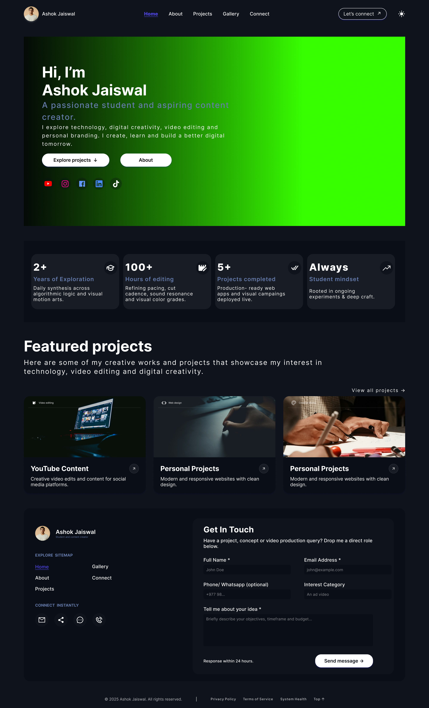
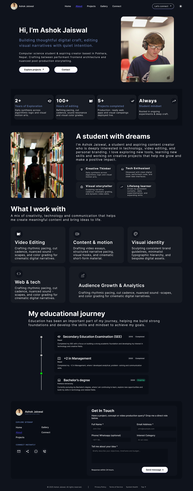
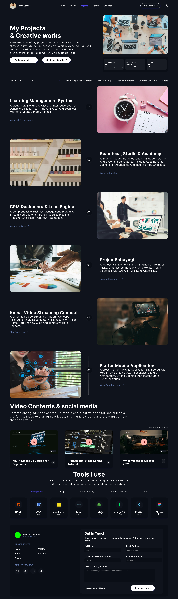
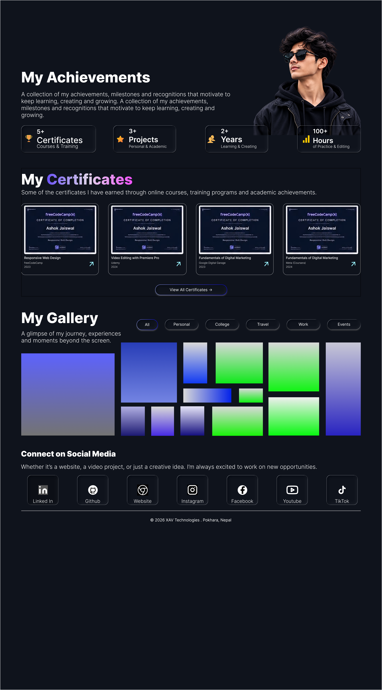
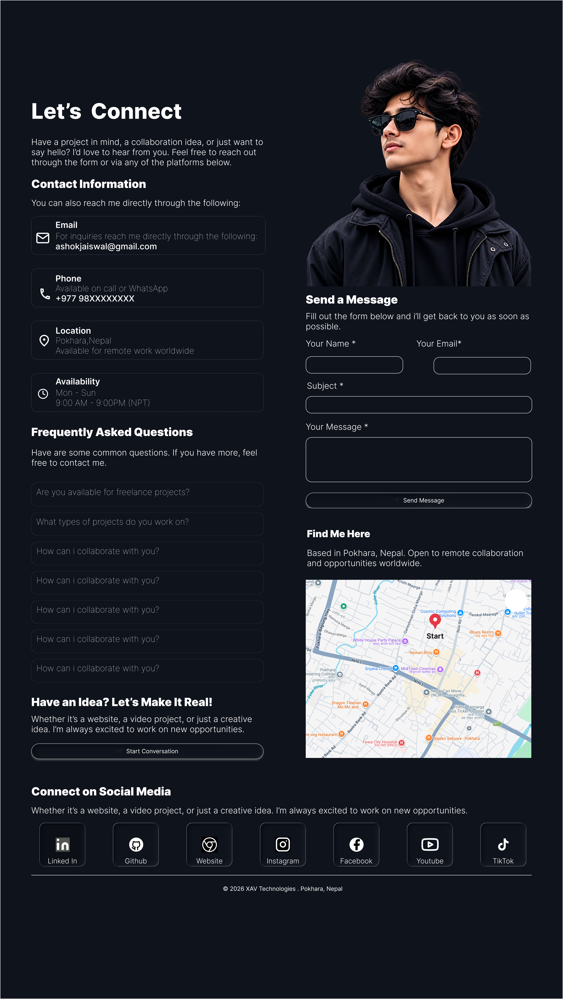

# Portfolio_UI_UX_Design
UI/UX design project for a personal portfolio website, focused on clean layouts, visual hierarchy, and user-friendly navigation.

# Personal Portfolio UI/UX Design

## Project Overview
A modern and user-friendly personal portfolio website designed in Figma.

## Design Tool
- Figma

## Figma Design
https://www.figma.com/design/UeDBx8jotXBHPoVzizbhmx/Ashok-Jaiswal?m=auto&t=bqMg2qNBmSIBn4f0-1

## Project Sections
- Home
- About Me
- Projects
- Gallery
- Contact

## Portfolio Design Preview
Home

About

Projects

Gallery

Connect

